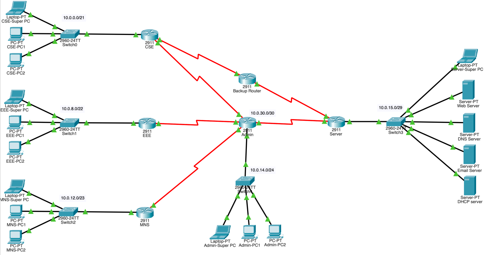
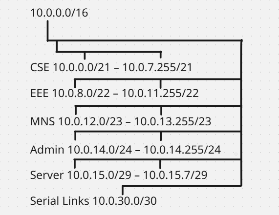

# Campus Network Design & Routing Simulation

**Cisco Packet Tracer | VLSM | RIPv2 | Static Routing | DHCP Relay | DNS | HTTP | Email**

A university campus network designed in **Cisco Packet Tracer** for five separate buildings: CSE, EEE, MNS, Administration, and Server. The simulation models a centralized server network, department-specific addressing, and an alternate CSE-to-Server route via a backup router.

This is an **academic network design and configuration project**. The design was sized for **2,955 users** using VLSM, with a small number of end devices representing each building in Packet Tracer. The full user population was *not* simulated.

## Network topology



*Actual Packet Tracer topology showing the Admin transit router, five building networks, and the backup route between CSE and Server. The image illustrates physical/logical connections; it does not by itself demonstrate working failover.*

## Problem and objectives

The task was to provide network connectivity and shared services for a temporary university campus while accommodating different building sizes and specific routing requirements:

- Allocate address space efficiently using **Variable Length Subnet Masking (VLSM)**.
- Provide centralized **web, DNS, email, and DHCP** services in the Server building.
- Assign client IP addresses from the DHCP server across routed networks, while keeping infrastructure and designated “Super PCs” on static addresses.
- Use **RIPv2** on the CSE, EEE, MNS, and Admin routers and **static routing** on the Server router.
- Make Admin the intended transit point to shared servers, with a separate **CSE → Backup Router → Server** path for an Admin-link failure scenario.

## IP addressing plan

Starting from the private `10.0.0.0/16` space, the network was divided into subnets suited to each building's planned population.

| Building | Planned users | Network | Gateway | Super PC (static) |
| --- | ---: | --- | --- | --- |
| CSE | 1,500 | `10.0.0.0/21` | `10.0.0.1` | `10.0.7.254` |
| EEE | 700 | `10.0.8.0/22` | `10.0.8.1` | `10.0.11.254` |
| MNS | 500 | `10.0.12.0/23` | `10.0.12.1` | `10.0.13.254` |
| Admin | 250 | `10.0.14.0/24` | `10.0.14.1` | `10.0.14.254` |
| Server | 5 | `10.0.15.0/29` | `10.0.15.1` | `10.0.15.6` |

Separate `/30` subnets in the `10.0.30.0` range are used for point-to-point router links. Detailed interface assignments are available in the [project documentation](project-documentation.docx).



## Network implementation

| Area | Configuration documented in the project |
| --- | --- |
| **Routing** | RIPv2 on CSE, EEE, MNS, and Admin; static routes on Server and Backup routers |
| **Alternate WAN path** | CSE connected to Server through an intermediate backup router, in addition to the intended Admin path |
| **DHCP** | Central server (`10.0.15.5`), building-specific address pools, and `ip helper-address` for CSE/EEE/MNS |
| **DNS** | DNS server (`10.0.15.3`) with `www.bracu.com` mapped to the local web server |
| **Web** | HTTP server (`10.0.15.2`) configured to show “Welcome To Brac University” |
| **Email** | Dedicated email server at `10.0.15.4`; complete mail delivery testing is not included in the written evidence |
| **Static addresses** | Gateway interfaces, servers, and designated Super PCs |

**Security scope:** The departmental networks have no direct interconnections, and the design intends to direct server access through Admin during normal operation. This is a *topology and routing design*, not evidence of firewall enforcement, traffic monitoring, or access-control rules.

## How to open and explore

1. Install **Cisco Packet Tracer** from an authorized Cisco distribution.
2. Download [`campus-network.pkt`](campus-network.pkt) and open it in Packet Tracer.
3. Review each router's interfaces and routing table, and inspect the server settings.
4. Use the following commands and checks to validate the implementation:

   - `show ip interface brief` — verify interface IPs and operational states.
   - `show ip route` — verify learned and static routes.
   - `ping` and `tracert` — check reachability and the chosen path to servers.
   - DHCP-configured departmental PC — inspect the assigned IP, subnet mask, gateway, and DNS.
   - PC web browser — visit `http://www.bracu.com` using the simulated DNS service.
   - Disconnect the **CSE–Admin** link — inspect both forward and return routes and retest server reachability through Backup.

**Verification note:** The included screenshot and written configuration records document the topology and intended behavior. Successful end-to-end services, backup-route switchover, and network-security properties have **not been independently verified** for this repository. The original router-command notes also contain items that should be checked against the actual Packet Tracer device configurations (for example, backup route preference, route advertisement, and DHCP pool reservations).

## Repository files

```text
├── README.md                    # Project overview and network design
├── campus-network.pkt           # Original Cisco Packet Tracer simulation
├── project-documentation.docx    # Professionally formatted, editable technical report
└── images/
    ├── topology.png             # Actual Packet Tracer screenshot
    └── vlsm-tree.png            # Original VLSM allocation diagram
```

## Project context

Built as a university networking assignment based on a fictional temporary-campus problem scenario. If this was a team project, individual responsibilities and contributor credits should be added before representing the work as a solo project on a CV.
